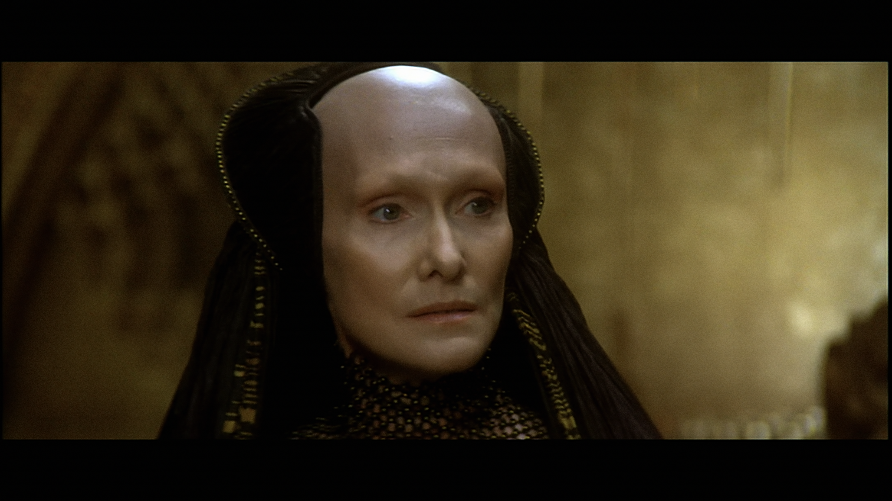
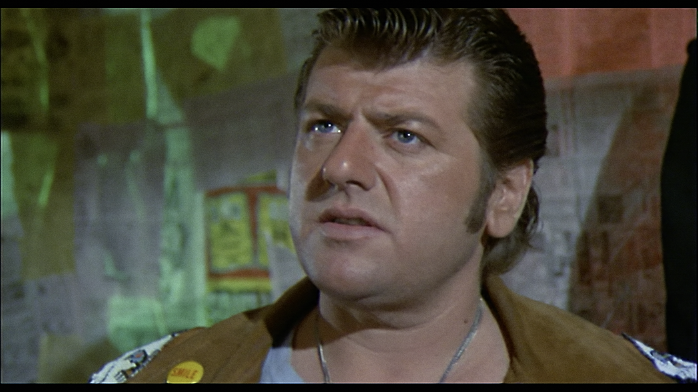
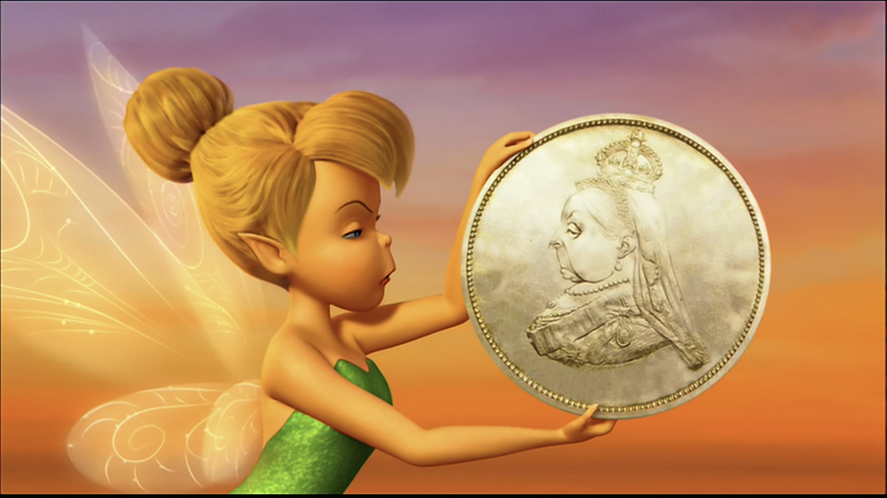
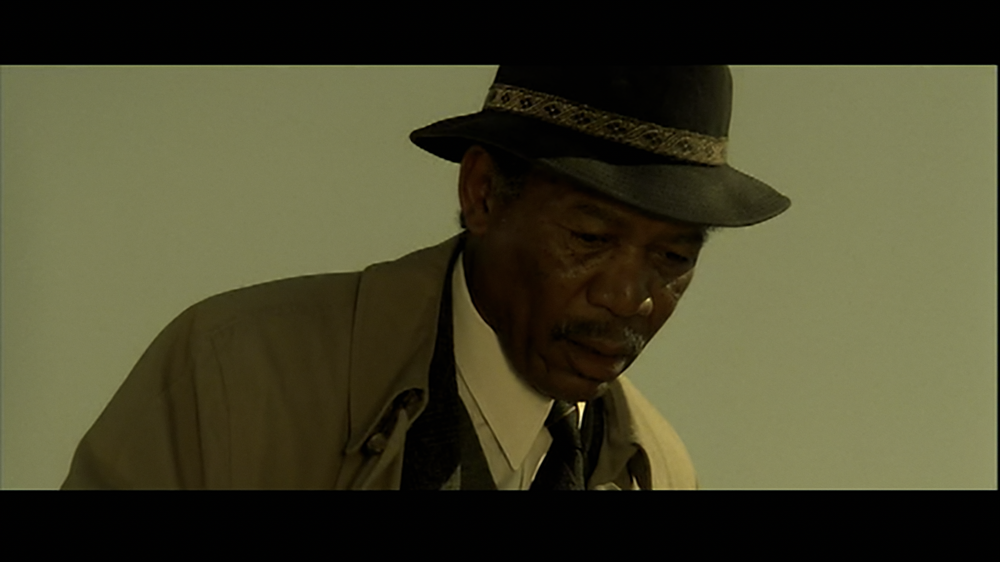

<p align="center">
  
</p>

<h1 align="center">🎞️ 4K Upscaler for all sources</h1>

<p align="center">
  <a href="https://mpv.io/"></a>
  
  
  <a href="LICENSE"></a>
</p>

---

### 🧭 Overview

It is a collection of GLSL shaders and profiles for **mpv** that upscale to 4K.
The goal is to have the best viewing experience on a 4K monitor, for any source resolution and bitrate.
A DVD will not become a UHD Blu-Ray, it will hold with good colors, very little noise, a subtle noise that feels like an optical zoom.
A mediocre 1080p web-dl will get a cleaner, more detailed image that feels higher bitrate.
A Blu-Ray will feel 4K even if not as detailed as a UHD.

---

## ⚙️ Installation

### Prerequisites

Install **mpv**: https://mpv.io/installation/

### Download the project

Go to the release page, download Assets → Source Code (zip)
https://github.com/frkfl/mpv-upscale4k/releases

### Add / Install this project

Clone **or** copy this project into your mpv configuration directory.

| OS          | Installation                                                                                          |
| :---------- | :---------------------------------------------------------------------------------------------------- |
| **Windows** | Copy all the project files into `%APPDATA%\mpv\` (usually `C:\Users\<YourName>\AppData\Roaming\mpv\`) |
| **macOS**   | Copy all the project files into `~/.config/mpv`                                                       |
| **Linux**   | Copy all the project files into `~/.config/mpv`                                                       |

> **Important:**  
> Copy the **contents** of the project into the mpv folder, not the folder itself.  
> The final layout should look like:
>
> - `mpv/mpv.conf`
> - `mpv/shaders/...`
> - `mpv/shaders-dl/...`
> - `mpv/profiles/...`
>
> **Not**: `mpv/mpv-upscale4k/mpv.conf`

### Add / Install this project (power users)

On Linux (and other Unix-like systems), you can clone directly into your mpv config dir:

```bash
git clone https://github.com/frkfl/mpv-upscale4k ~/.config/mpv
```

---

## ▶️ How to use

Once the files are in your mpv config folder, you just play videos with mpv as usual.  
The restoration / upscaling runs automatically.

### Opening a video

| OS          | How to open a video with mpv                                                                                                 |
| :---------- | :--------------------------------------------------------------------------------------------------------------------------- |
| **Windows** | Open **Explorer** → find your video → right-click → **Open with → mpv** (or drag the file onto `mpv.exe` / an mpv shortcut). |
| **macOS**   | Drag the video file onto the **mpv** app (Dock / Applications), or run `mpv /path/to/file.mp4` in Terminal.                  |
| **Linux**   | From a terminal: `mpv your_video_file.mkv`, or in your file manager: right-click → **Open With → mpv**.                      |

### Toggling the processing

The video processing is enabled by default.
While a video is playing, you can enable/disable the processing:

- Press **`Ctrl + S`** to **turn processing off** and see plain mpv scaling.
- Press **`Ctrl + S`** again to **turn processing back on**.

This lets you instantly compare:

- the original player output
- the result of this project improvements

## DVD Results

Originally, the format was made to look good on a CRT TV through SCART, or worst. So, virtually nothing just displays the result of the codec on a LCD display: VLC heavily tampers with colors and framerate interpolation, dvd player devices largely rework the result. So giving a "before" is genuinely hard, and most certainly not the director's intent.

To me, what matters is that it is not plastic, with clear colors, and details that really are on the DVD, for a result that feels resolution-less in 4K, rather than 4K.
Obligatory, it looks much better in motion.

| Movie                        | Picture                                                                                                                                |
| :--------------------------- | :------------------------------------------------------------------------------------------------------------------------------------- |
| Dune 1984                    |                  |
| Phantom of the Paradise 1974 |  |
| Tinkerbell 2008              |        |
| Seven 1995                   |                            |

## 1080p

The improvement is real, but debatable. Give it a test. I have a profile for BR's bitrate, and one for web-dl. It will switch automatically.

Again, it is hard to compare to a "source". For example Aliens' BR has some fine digital grain on a cleaned pictured. It was already criticized, despite being supervised by Cameron. Anyway, in 4K, the 2K trick fails as the pixel size noise is blurred with a bicubic or equivalent. And that looks bad on my monitor but that does not matter on my LG TV, because even if you deactivate every processing, a temporal cleaning remove them, and destroys pans. I do believe I have a much better result with my shaders as I don't rely on a single trick.

## 📜 License

All shaders and configs are released under the MIT License.
You may freely copy, modify, and redistribute. Credit appreciated but not required for my own shaders (~/shaders/). For the others, see their content.

---

## 💡 Credits

Shader math inspired by FSRCNNX, SSimSuperRes, and Björn Ottosson’s OkLab for color space normalization.
Also Matthias Gustavsson for the CRT emulation that really improved the analog feel on DVD.
João Chrisóstomo for Chroma from Luma that is so major for 4:2:0 sources like DVD.
And many other people and shaders in ~/shaders-dl.

## Specs

Tested on a RTX 3080 / mpv-gpu-next Vulkan backend.
The GPU usage goes up to 60%. It could be cut a lot, especially for lower resolutions where temporal sharpen are not that relevant.
